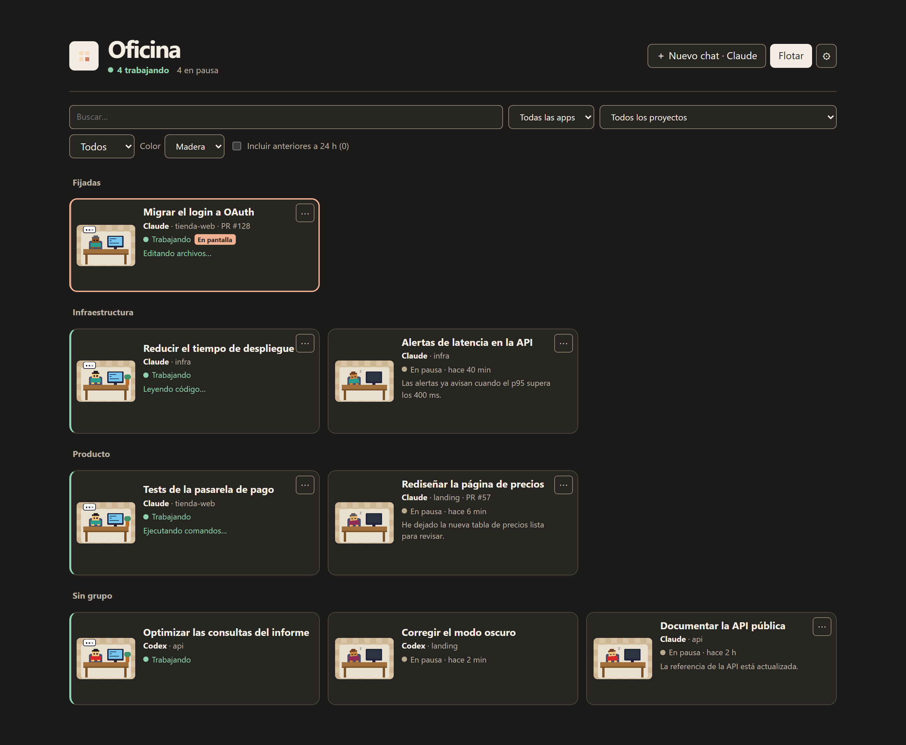
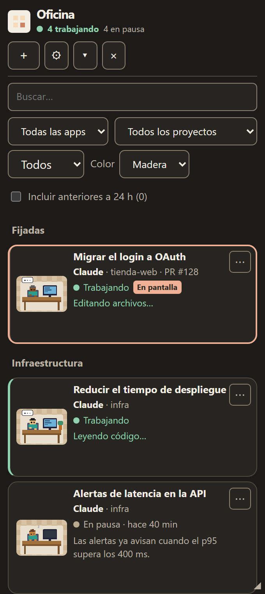

# Oficina de agentes

[](https://github.com/RaclosDev/oficina-agentes/actions/workflows/ci.yml)
[](LICENSE)


Una oficina pixel para tus sesiones de **Claude Code** y **Codex**: cada sesión es un personaje en su escritorio que teclea mientras trabaja y se echa una siesta cuando está en pausa.
Vive en una ventana flotante siempre encima, así ves de un vistazo qué agente sigue trabajando y cuál te espera.



<sub>Captura con los datos de ejemplo de `npm run demo`.</sub>

## Qué hace

**Ver**

- Una tarjeta por sesión con su título, aplicación, proyecto, PR, estado y tiempo en pausa.
- Qué está haciendo cada una: «Editando archivos…» mientras trabaja, o la primera frase de su último mensaje cuando para.
- La sesión que tienes abierta queda marcada, y las que han terminado desde la última vez que las viste llevan «Nuevo».
- Buscador y filtros por aplicación, por proyecto y por presencia (todas o solo en línea).

**Actuar**

- Un clic en una tarjeta te lleva a ese chat en Claude o en Codex.
- Menú ⋯ con lo mismo que la barra lateral de Claude: fijar, renombrar, mover de grupo, marcar como no leída, detener, archivar y eliminar.
- Arrastra una tarjeta a otro grupo, a Fijadas o a Sin grupo.
- Aviso opcional (sonido y notificación del sistema) cuando una sesión termina.

**Personalizar**

- Ventana flotante sin bordes que se ajusta al número de sesiones y se pliega.
- Modo claro, oscuro o el del sistema, y colores de suelo y alfombra por proyecto.
- 20 idiomas.

<details>
<summary>Vista compacta de la ventana flotante</summary>



</details>

## Requisitos

- **Node.js 18 o superior** en el PATH. El servidor local no tiene dependencias.
- Para la ventana flotante siempre encima: **Windows con Microsoft Edge**.

## Instalación

### Claude Code

En la app de escritorio: **+** junto al cuadro de mensaje → **Plugins** → **Add marketplace** con `RaclosDev/oficina-agentes` → **Add plugin** → **oficina-agentes**.

En una sesión de terminal:

```
/plugin install oficina-agentes --marketplace RaclosDev/oficina-agentes
```

Desde una shell:

```bash
claude plugin install oficina-agentes --marketplace RaclosDev/oficina-agentes
```

### Codex

Con una versión de Codex que admita plugins con hooks:

```bash
codex plugin marketplace add RaclosDev/oficina-agentes
```

```bash
codex plugin add oficina-agentes@oficina-agentes
```

Abre Codex en la terminal, escribe `/hooks` y habilita los hooks de **oficina-agentes**. Al enviar el primer mensaje de un chat local, la oficina arranca en <http://127.0.0.1:3210>.

Los dos plugins comparten servidor y puerto. Si ya usabas la oficina con Claude, actualiza también ese plugin y reinicia el proceso de Node que la sirve.

## Uso

| Dónde | Cómo |
| --- | --- |
| Claude Code | `/oficina` abre la ventana flotante (o la página en tu navegador si no se puede fijar). |
| Claude Code | `/oficina-panel` abre la oficina junto al chat, dentro de la app. |
| Claude Code | `/oficina-permisos` indica si faltan permisos para las acciones del menú. |
| Navegador | <http://127.0.0.1:3210> con el servidor en marcha; **Flotar** abre la ventana flotante. |

Cerrar la ventana no detiene ningún chat.

### Permisos en Claude Code

Un plugin no puede concederse permisos a sí mismo. Para que las acciones del menú funcionen sin preguntar cada vez, añade estas reglas a `permissions.allow` en `~/.claude/settings.json`:

```json
"mcp__ccd_session_mgmt__stop_session",
"mcp__ccd_session_mgmt__archive_session",
"mcp__ccd_sidebar__set_pinned",
"mcp__ccd_session_mgmt__set_session_title",
"mcp__ccd_sidebar__move_sessions",
"mcp__ccd_sidebar__set_unread"
```

Eliminar una sesión siempre pide tu aprobación, tengas las reglas o no.

## Cómo funciona

```
Claude Code ── hooks/register.tsx ──┐  lista de sesiones cada 15 s
                                    ├─▶ server/server.mjs ── SSE ──▶ server/index.html
Codex ──────── codex/report.mjs ────┘   127.0.0.1:3210               (página y ventana flotante)
```

- **Servidor** ([server/server.mjs](server/server.mjs)): HTTP sin dependencias que solo escucha en `127.0.0.1`. Guarda el estado en memoria y lo envía a la página por Server-Sent Events.
- **Claude Code** ([hooks/register.tsx](hooks/register.tsx)): el mod pide a la app la lista de sesiones, la envía al servidor y ejecuta, con tus permisos de siempre, las acciones que la página encola (detener, archivar, fijar…).
- **Codex** ([codex/](codex)): los hooks envían el tipo de evento, los identificadores del chat y del turno y el nombre de la carpeta. El servidor completa la lista con el servidor de aplicaciones de `codex` y los títulos con su índice local. Archivar y eliminar pasan por el conector de la app de escritorio y conservan su confirmación.
- **Ventana flotante** ([server/window.mjs](server/window.mjs), [server/pin.ps1](server/pin.ps1)): Edge en modo app, sin bordes y siempre encima mediante la API de Windows.

**Privacidad y seguridad.** Los datos no salen de tu ordenador. El servidor solo acepta escrituras con una cabecera propia que una web ajena no puede enviar, y solo abre enlaces `claude://` y `codex://` de sesión.

## Desarrollo

No hay nada que instalar: clona el repositorio y usa los scripts.

| Comando | Qué hace |
| --- | --- |
| `npm test` | Tests del servidor, de la integración con Codex y de los manifiestos (`node --test`). |
| `npm run test:mod` | Tests del mod de Claude Code (`hooks/*.test.tsx`). Necesita la CLI `claude`. |
| `npm run validate` | Valida los manifiestos del plugin. Necesita la CLI `claude`. |
| `npm run demo` | Arranca la oficina con sesiones de ejemplo en <http://127.0.0.1:3211>. |
| `npm start` | Arranca el servidor en el puerto 3210 (`OFICINA_PORT` para cambiarlo). |

La integración continua ejecuta los tests en cada push y pull request a `main`.

```
.claude-plugin/   manifiesto y marketplace del plugin de Claude Code
.codex-plugin/    manifiesto del plugin de Codex (.agents/ es su marketplace)
hooks/            mod de Claude Code y sus tests
codex/            hooks de Codex, lectura de chats y conector de escritorio
server/           servidor local, página y ventana flotante
scripts/          datos de ejemplo
```

## Limitaciones

- La ventana flotante propia solo existe en Windows con Edge; en otros sistemas la página recurre al Picture-in-Picture del navegador.
- Los grupos y el menú ⋯ completo son de Claude Code. En Codex se puede abrir, archivar y eliminar.
- Archivar y eliminar chats de Codex necesita la app de escritorio en Windows; sin ella solo se pueden modificar los chats que la app no tenga cargados. Con varias instancias abiertas hay que indicar el conector con `CODEX_APP_TOOLS_PIPE_PATH`.
- Se cargan como máximo 40 sesiones de Claude Code y 50 chats de Codex.
- El estado vive en memoria: al reiniciar el servidor la oficina se rellena con el siguiente envío.

## Licencia

[MIT](LICENSE)

## Autor

**Carlos Sanz Tomero** · [raclosdev.github.io](https://raclosdev.github.io) · [LinkedIn](https://www.linkedin.com/in/carlos-sanz-tomero/)
